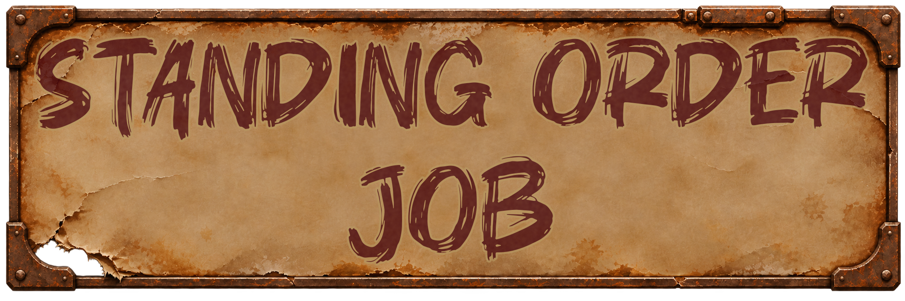
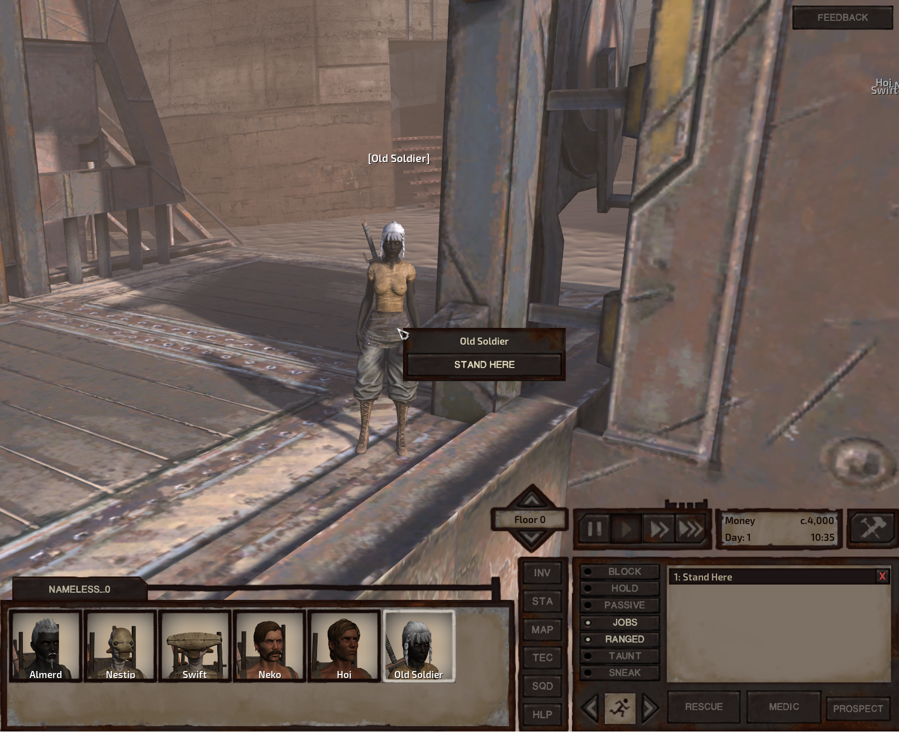

<p align="center"><a href="https://steamcommunity.com/sharedfiles/filedetails/?id=3846152406">Steam Workshop</a> · <a href="https://www.nexusmods.com/kenshi/mods/2308">Nexus Mods</a></p>

# Standing Order Job - A Meitou Client mod for Kenshi

Pin squadmates to a spot and keep them there. Useful for gate guards and wall archers. Right-click a player character and choose Stand Here for a one-shot move, or hold Shift to assign a permanent Stand Here job — the same context-menu convention Kenshi already uses for other jobs.

## Features

- Adds `Stand Here` to a player character's hold-right-click menu when they are selected and non-animal.
- Unshifted `Stand Here` orders eligible selected characters to the clicked character's position once without altering existing jobs.
- Shift+`Stand Here` adds or updates a permanent `Stand Here` job in-place (preserving job-list priority) with one standing coordinate per character.
- Characters walk to their assigned point and hold within `1.5m` horizontal distance until a higher-priority task or player order interrupts them.
- Combat, incapacity, carrying, and other standard interruptions use normal task precedence; eligible characters resume standing afterward (an active in-range `Stand Here` blocks lower jobs below it).
- Configurable maximum return distance in **Mods → Standing Order Job** (defaults to `652m` to match Meitou's vanilla job range; set `0` for unlimited); out-of-range characters skip `Stand Here` without disabling `Jobs` or erasing their saved spot and resume automatically once back in range.
- Respects the Jobs toggle, cleans up automatically when removed from the Jobs panel, and preserves assigned positions across zone unloads and save/load.

## Screenshots



## Installation

1. Download the latest `StandingOrderJob-<version>.zip` archive from [GitHub Releases](https://github.com/GardenGoblin-Kenshi-Mods/Standing-Order-Job/releases/latest).
2. Extract the archive to get the `StandingOrderJob/` folder (containing `StandingOrderJob.mod`, `meitou.json`, and `StandingOrderJob.dll`).
3. Verify the SHA-256 checksums and provenance attestations of the downloaded `StandingOrderJob-<version>.zip` and extracted `StandingOrderJob/StandingOrderJob.dll`, `StandingOrderJob/StandingOrderJob.mod`, and `StandingOrderJob/meitou.json` against the **Build provenance & checksums** section in the release notes (see [Build Transparency & Verification](#build-transparency--verification) below).
4. Move or symlink the `StandingOrderJob/` folder into your Kenshi `mods/` directory (used by Meitou Client) so the final path is `<Kenshi>/mods/StandingOrderJob/StandingOrderJob.mod`:
   - **Linux / macOS symlink:** `ln -s /path/to/StandingOrderJob "<Kenshi>/mods/StandingOrderJob"`
   - **Windows symlink (PowerShell):** `New-Item -ItemType SymbolicLink -Path "<Kenshi>\mods\StandingOrderJob" -Target "C:\path\to\StandingOrderJob"`
5. Enable `StandingOrderJob.mod` in the Meitou Launcher (or add `StandingOrderJob.mod` to `<Kenshi>/data/mods.cfg`) and launch Meitou Client.

## Requirements

- **[Meitou Client](https://github.com/VlcekM/MeitouClient)** (latest version; for older Meitou Client compatibility versions, see GitHub Releases)

## Issues/Incompatibility

Please report bugs, incompatibilities, or other issues on the [GitHub Issues](https://github.com/GardenGoblin-Kenshi-Mods/Standing-Order-Job/issues) page. Issues posted on Nexus Mods or Steam Workshop may be overlooked.

## Build Transparency & Verification

> **Note:** Meitou code mods run compiled C# code within the game process with your user account's permissions. As with any third-party executable, only install mods from sources you trust. Checksums and attestations verify artifact integrity and build provenance but do not guarantee that code is free of bugs or security issues.

**Standing Order Job** releases are built through GitHub Actions with reproducible builds, published checksums, and build provenance attestations. Anyone can inspect the source, trace a release to its originating commit, or independently verify its contents.

### Release Transparency

Every release includes:

- **Traceable source:** Links to the exact source commit, release tag, and GitHub Actions build. These are also included in Nexus Mods and Steam Workshop changelogs, which deploy the exact verified GitHub Release artifacts without rebuilding.
- **Reproducible builds:** A locked Nix environment pins the .NET 11 SDK, MeitouClient revision, and NuGet dependencies. Builds run offline in a sandbox.
- **Inspectable DLL:** Deterministic Release compilation with embedded debugging symbols, source files, and Source Link metadata for inspection with [ILSpy](https://github.com/icsharpcode/ILSpy).
- **Checksums & build logs:** SHA-256 manifests for the release archive and its contents, plus an MSBuild binary log (`StandingOrderJob.binlog`).
- **GitHub attestations:** Build provenance attestations for both the release ZIP and compiled DLL, linking the published binaries to their originating workflow.

### Verify a Release

Download the release archive and accompanying checksum files from GitHub.

**GitHub attestations** (requires [GitHub CLI](https://cli.github.com/)):

```bash
gh attestation verify StandingOrderJob-<version>.zip --repo GardenGoblin-Kenshi-Mods/Standing-Order-Job
gh attestation verify StandingOrderJob/StandingOrderJob.dll --repo GardenGoblin-Kenshi-Mods/Standing-Order-Job
```

**SHA-256 checksums (Linux):**

```bash
sha256sum -c StandingOrderJob-<version>.zip.sha256
sha256sum -c StandingOrderJob-<version>.contents.sha256
```

**SHA-256 checksums (Windows PowerShell):**

```powershell
Get-FileHash StandingOrderJob-<version>.zip -Algorithm SHA256
Get-FileHash StandingOrderJob\StandingOrderJob.dll -Algorithm SHA256
```

### Inspect or Reproduce the Build

- **Source & CI:** Follow the commit and workflow links in the GitHub Release or Nexus Mods changelog.
- **DLL inspection:** Open `StandingOrderJob.dll` in [ILSpy](https://github.com/icsharpcode/ILSpy) to inspect the compiled code and embedded sources.
- **Local builds:** Check out the release tag in a Nix-enabled Linux environment (or WSL2) and run:

```bash
./tools/package.sh
./tools/verify-reproducibility.sh
```

The verification script compares locally built artifacts against the published release.

## AI disclosure

This mod is designed, architected, and reviewed by me, but much of the code is AI-generated. Documentation and supporting development tools also contain AI-generated content. <u>**This mod does not contain any AI generated art, models, prose, or audio.**</u>

I respect the strong feelings surrounding AI and deeply share the concerns about its impact on artists, workers, communities, and the environment. These are important issues that require meaningful action; I encourage those who feel strongly about these issues to push for protections and accountability through their communities, local, and national governments.

For me AI is a tool that makes creative projects like this more accessible. I work a demanding job, and AI allows me to put my 14 years of software development experience and love for these games toward bringing ideas I'd like to see in the game to life. Without it, many of these ideas would likely remain just that. I'm glad to be able to share them, and I hope you enjoy them too.

## Documentation

- `docs/behaviors.md`: authoritative behavior & feature specification (testing North Star).
- `docs/package.md`: packaging, staging, load order, and debug trace.
- `docs/implementation-notes.md`: design decisions and runtime invariants.
- `AGENTS.md`: mod-local agent guidance for AI coding assistants.

## License

This mod is licensed under the GNU General Public License v3.0 (GPLv3). See [`LICENSE`](LICENSE) for the full text.
